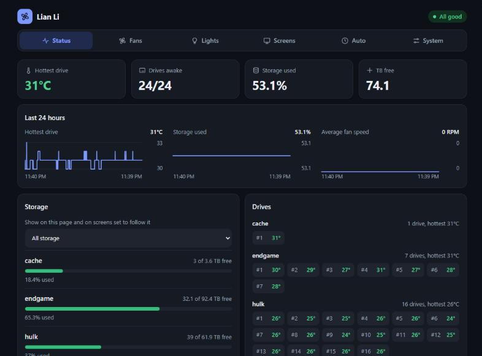
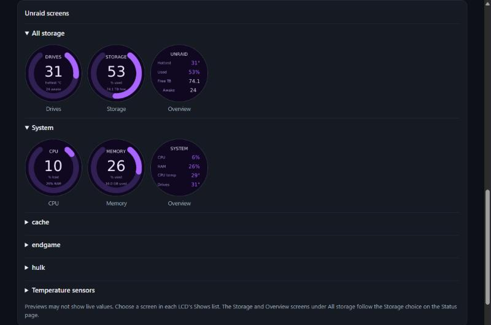
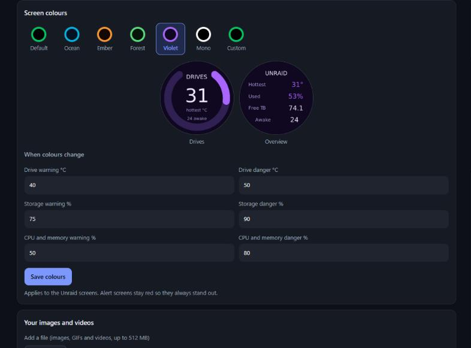
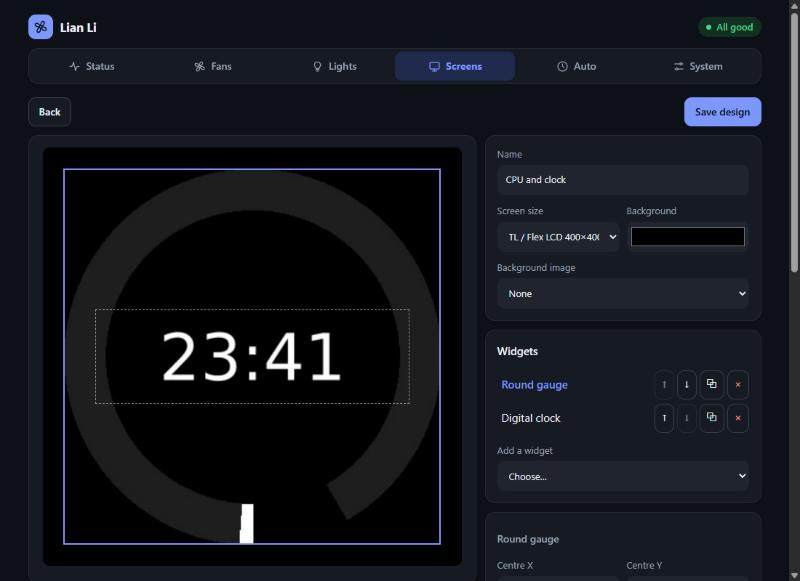
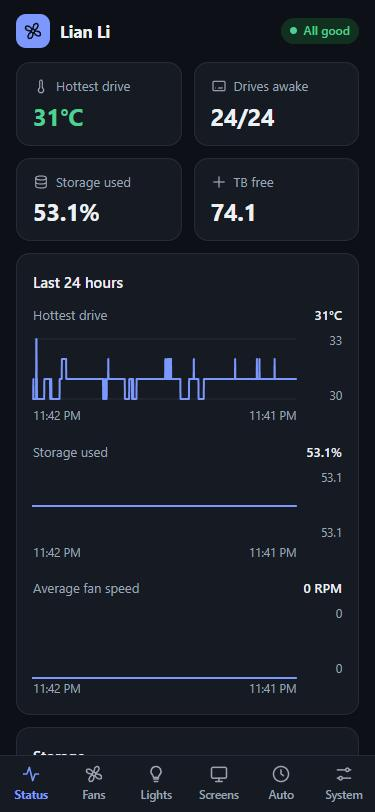

<div align="center">


# Lian Li Linux for Unraid

**Control your Lian Li fans, lights, AIO and LCD screens from Unraid, and show your server's stats on them. No Windows or L-Connect 3 needed.**

[](https://github.com/teh1percent/lian-li-linux-unraid/actions/workflows/docker.yml)
[](LICENSE)
[](https://github.com/sgtaziz/lian-li-linux)

[Install](#install) · [Features](#features) · [Screenshots](#screenshots) · [Hardware](#hardware) · [Troubleshooting](#troubleshooting) · [Get help](#get-help)



</div>

## Features

Everything runs from a phone-friendly web dashboard, built on the open-source
[Lian Li Linux](https://github.com/sgtaziz/lian-li-linux) project by
[sgtaziz](https://github.com/sgtaziz).

| Feature | What it does |
|---|---|
| **Unraid stats on your LCDs** | Show drive temperatures, storage per pool, CPU, memory and system temperatures. Each LCD can show a different pool. |
| **Fan curves that follow your drives** | Fans can follow the hottest drive, the average drive, one pool or a hardware sensor. Sleeping drives are never woken. |
| **Lighting** | Effects, colours, brightness and speed per fan group, with saved presets and optional OpenRGB control. |
| **Screen designer** | Build your own LCD screens with drag-and-drop text, gauges, charts, clocks, images and video. |
| **Colour themes** | Choose a built-in theme or your own colours, and set when gauges change colour. |
| **Schedules and alerts** | Dim screens overnight, and take over every screen for a hot drive, a disk problem or a nearly full pool. |
| **AIO control** | Pump and radiator fan speeds, curves and pump screen settings, on supported AIOs. |
| **Password protected** | The dashboard asks you to create a password the first time you open it. |

## Screenshots

<table>
  <tr>
    <td width="50%"></td>
    <td width="50%"></td>
  </tr>
  <tr>
    <td align="center"><b>LCD screens</b>, generated for your pools and sensors</td>
    <td align="center"><b>Colour themes</b> and warning limits</td>
  </tr>
  <tr>
    <td></td>
    <td align="center"></td>
  </tr>
  <tr>
    <td align="center"><b>Screen designer</b> for your own layouts</td>
    <td align="center"><b>Works on your phone</b></td>
  </tr>
</table>

## Install

**You'll need:** an Unraid server on an amd64 CPU, with your Lian Li controller, AIO, LCD or wireless dongle plugged in by USB.

### Step 1: Add the container

**From Community Applications**, once the app is listed there: open the **Apps** tab, search for `lian-li-linux` and click **Install**.

**By hand**, until then: run this in Unraid's terminal to download the template.

```bash
wget -O /boot/config/plugins/dockerMan/templates-user/my-lian-li-linux.xml https://raw.githubusercontent.com/teh1percent/lian-li-linux-unraid/main/templates/lian-li-linux.xml
```

Then go to **Docker → Add Container** and choose `lian-li-linux` from the **Template** list.

### Step 2: Apply

The defaults work for most servers, so click **Apply**. You don't need to pass any USB devices through yourself, because the container runs in privileged mode and finds them on its own.

### Step 3: Create your password

Click the container's icon and choose **WebUI**, or go to `http://<your-server>:6090`.

> [!IMPORTANT]
> Do this right after installing. Until a password exists, the first person to open the page gets to choose it.

### Step 4: Set up your hardware

- **Wireless fans:** pair them on the **System** page.
- **LCD screens:** open **Screens** and choose what each one shows.
- **Fan speeds:** open **Fans** and set a fixed speed or create a curve.

> [!WARNING]
> Run only one copy. Don't run two of these containers, or one alongside a Lian Li Linux install on the host, because they would fight over the same hardware.

## Settings

| Setting | Default | What it's for |
|---|---|---|
| Dashboard port | `6090` | The web dashboard. |
| AppData | `/mnt/user/appdata/lian-li-linux` | Settings, fan curves, designs and uploads. |
| LCD media | `/mnt/user/appdata/lian-li-linux/media` | Images and videos to pick from. You can also upload them on the dashboard. |
| Unraid state | `/var/local/emhttp` | Unraid's status files, read-only. This is where drive and pool stats come from. |
| Reset dashboard password | `no` | See [Forgot your password?](#forgot-your-password) |
| OpenRGB port | not published | Only needed to control the lights from OpenRGB on another computer. |
| Log level | `info` | Set to `debug` for more detail in the logs. |
| PUID / PGID | `99` / `100` | The user and group the app runs as. |

The last few are under **Show more settings** in the container's settings.

## Hardware

Tested in this container with **UNI FAN TL V3 Wireless LCD** fans and a wired **TL Flex LCD** screen.

**Wired TL Flex LCD:** upstream v1.2.6 includes the fix that stops TL Flex firmware 2026072401 freezing on its first frame. This image adds `patches/tl-flex.patch`, which keeps the receivers polled the way L-Connect does so the screens stay awake, dims Flex screens in software, and keeps frames within the panel's buffer. `patches/wired-reopen.patch` stops controllers failing to reopen with "Resource busy" after another controller resets. If a TL Flex screen is already frozen, turn the PSU off for 30 seconds, then start the server again.

The daemon from [Lian Li Linux](https://github.com/sgtaziz/lian-li-linux) does the hardware work, and supports fans, AIOs, Strimers, LCD screens and wireless dongles. Other devices use the same code but may not have been tried on Unraid yet. Please [open an issue](https://github.com/teh1percent/lian-li-linux-unraid/issues) to say how yours went.

## Forgot your password?

1. Edit the container and click **Show more settings**.
2. Set **Reset dashboard password** to `yes` and click **Apply**.
3. Open the dashboard and create a new password.
4. Set the option back to `no` and click **Apply**.

Your fan, lighting and screen settings aren't affected. Leaving it on `yes` won't wipe the new password on a restart, but it has to go back to `no` before it can reset again.

## Security

- **Why privileged?** The daemon needs raw USB access, and fan curves need the host's temperature sensors.
- **Keep it on your local network.** The dashboard uses plain HTTP, so the password isn't encrypted as it travels. For remote access, use a VPN or an HTTPS reverse proxy, and don't port-forward it to the internet.
- **Password storage:** only a salted hash is stored, in `extras/auth.json` in AppData. Five wrong passwords from one address block sign-in for a minute.
- **Fixed operations only:** the API only offers fixed operations with validated values. It can't set sensor commands, because the daemon runs those as shell.
- **OpenRGB has no password.** Its server is off until you turn it on, and its port isn't published by default.

## Troubleshooting

**The dashboard shows no devices.** Check that the container can see them:

```bash
docker exec lian-li-linux sh -c 'ls -l /dev/hidraw* /dev/bus/usb/*/*'
```

**A fan group reads 0 RPM.** That reading comes from the fans themselves, over the radio. Check that they have power and are plugged into the controller.

**Drives show 0 on the LCD.** All your drives are asleep. The app reads Unraid's status files, so it never wakes them.

**ZFS pool problems don't trigger an alert.** Alerts use Unraid's per-disk status, so ZFS pool health and scrub results aren't included.

**Check the values the LCD screens use:**

```bash
docker exec lian-li-linux sh -c 'grep . /run/lianli-stats/*'
```

**Run upstream's diagnostic tool:**

```bash
docker exec -u lianli lian-li-linux lianli-control diagnose-runtime
```

**A TL Flex screen froze.** Turn the PSU off for 30 seconds to reset it; restarting the container is not enough. If it keeps freezing, the log line `Flex opening packet` shows whether the opening sequence ran. To turn parts of the fix off for testing, add these variables to the container: `LIANLI_FLEX_OPEN=0` (opening sequence), `LIANLI_FLEX_PNG_LAYER=0` (PNG layer before each frame), `LIANLI_FLEX_KEEPALIVE=0` (receiver keepalive).

**Read the logs:** go to the Docker tab, click the container's icon and choose **Logs**. The **System** page can also download a diagnostics report. Read it before sharing it.

## Limitations

- **Desktop mode** (using an LCD as a monitor) isn't available. Upstream only supports it on the HydroShift II, Lancool 207, Universal Screen 8.8" and Vision 9.2", not on LCD fans, and it needs a graphical login that this container doesn't have. A screen left in that mode gets a **Return to LCD mode** button.
- **amd64 only**, because upstream only ships amd64 packages.
- **No service controls:** supervisord keeps the daemon running, so the desktop app's systemd controls aren't offered. **Installation Health** may flag systemd and udev items.
- **Image size:** the image still installs the libraries the upstream package depends on, so it's larger than it could be.

## Everything on the dashboard

<details>
<summary><b>See each page in detail</b></summary>

- **Status:** hottest drive, storage per pool and array, fan speeds, and parity state if you have a classic array. The **Storage** picker chooses whether the page and the main Storage and Overview LCD screens show all storage or one pool. Charts show the last 24 hours of drive temperature, storage and fan speed.
- **Fans:** fixed speed or a fan curve, per group, on all groups, or for each fan. Groups can follow the motherboard. Curves can follow the hottest drive, the average drive temperature, the hottest drive in one pool, or a hardware temperature sensor. **Curve smoothing** stops fans hunting around a curve point. Speeds stop at 20%, so fans can't be stopped by accident.
- **AIO:** this tab appears when an AIO is connected. Set the pump and radiator fans to automatic, a fixed speed or a fan curve, or to follow the motherboard if the AIO supports it. Fixed pump speeds stop at 30%. Curves can follow coolant temperature on AIOs that report it. The pump screen's brightness, theme, rotation, colours and sensors are also here.
- **Lights:** effect, colours, brightness, speed and direction per fan group, or all at once. Depending on the hardware, set each zone or region separately, colour single LEDs, swap directions, change the LEDs per fan, or follow the motherboard. **Presets** and **Saved setups** store lighting under a name. **Quick Sync** runs one effect across several devices. The **OpenRGB server** lets OpenRGB control the lights.
- **Screens:** what each LCD shows: an Unraid screen, your own design, a sensor gauge, your own file or a solid colour, plus brightness, rotation and colours. The Drives, Storage and Overview screens have a **Pool** choice on each LCD, and new pools appear automatically. **System** screens show CPU usage, memory usage, a system overview or a temperature sensor, and these gauges change colour at 70 and 85 °C. Per-core, Wi-Fi and extra drive or network readings don't get their own screen, but are in the gauge list. Files can be positioned and zoomed, and videos can set their frame rate. **Startup image** sets what a screen shows at power-on. **Screen designs** is the drag-and-drop designer. **Template catalog** installs ready-made designs from GitHub, and **Stored template files** clears out leftovers. Upload files here, and start pixel cleaning.
- **Auto:** schedules (brightness, optional screen swap, optional lights off) and alerts that take over every screen for a hot drive, a disk problem, parity errors, a nearly full pool or hot AIO coolant. Muting lasts 24 hours. Schedules don't change fan speeds.
- **System:** pair, unpair, take over, identify, rename and restart devices. General settings include the USB backend and a temperature alert on the lights. **Restore a backup** previews and restores the daemon's own backups. Also here: your password, Installation Health, a diagnostics report, an update check, and the version and credits under **About**.

An LCD left on **Leave as it is** is only touched while an alert or a screen-swapping schedule is active, and is restored afterwards.

Settings are stored in `extras/settings.json` in AppData, chart data in `extras/history.json` and uploads in `extras/media`.

</details>

## For developers

<details>
<summary><b>How it works and how to build it</b></summary>

One container runs:

- `lianli-daemon --system` as the `lianli` user, the same way upstream's `lianli-daemon-system.service` does. It keeps fan curves, RGB and LCDs running.
- The dashboard on port 6090, plus the Unraid stats and LCD automation (Node, no dependencies).

The image installs the upstream **Debian 13 release `.deb`**, checked against the release's `SHA256SUMS`, so there is no Rust or Node build. The upstream desktop GUI is removed, so there's no X display, VNC or second port.

### Layout

```
Dockerfile                       debian:trixie-slim + upstream .deb
rootfs/usr/local/bin/
  entrypoint.sh                  container setup that systemd/tmpfiles/udev would normally do
  sync-devices.sh                mirrors /dev/bus/usb and /dev/hidraw* from sysfs (udev stand-in)
rootfs/opt/lianli-extras/        dashboard, Unraid stats and LCD automation
rootfs/etc/supervisor/supervisord.conf
tests/                           mock daemon tests and template checks
templates/lian-li-linux.xml      Unraid Docker template
screenshots/                     images for this page and the app listing
ca_profile.xml, icon.*, LICENSE  Community Applications repository files
.github/workflows/docker.yml     builds and pushes to ghcr.io
```

### Build and test

Every push to `main` builds and pushes `ghcr.io/teh1percent/lian-li-linux-unraid:latest` and `:<version>`. To follow a new upstream release, change `ARG LIANLI_VERSION` in the `Dockerfile`, or run the workflow by hand with the version as input.

To build on the Unraid server, then set the template's Repository to `lian-li-linux-unraid:latest`:

```bash
docker build -t lian-li-linux-unraid:latest .
```

To run the tests:

```bash
node --test tests/*.test.js
```

### The container check

Upstream's daemon won't start if it detects a generic container. It looks for `/.dockerenv`, `$container` or `/run/.containerenv`, then exits with *"Cannot verify host-wide daemon ownership from this container"*. The check exists because the daemon can't see a host-side daemon that might be driving the same hardware. On Unraid nothing else drives that hardware, so `entrypoint.sh` removes those markers and the daemon runs in its normal system mode. It still takes its usual ownership lock, inside the container.

The entrypoint also does what the distro packaging normally handles:

- creates `/run/lianli-daemon.lock` and `/run/lianli-control.lock` (tmpfiles.d)
- creates `/run/lianli` for the socket (systemd `RuntimeDirectory`)
- remaps the `lianli` user to `PUID:PGID` and owns `/var/lib/lianli` (systemd `StateDirectory`)
- starts `sync-devices.sh`. Every 3 s it recreates `/dev/bus/usb/*/*` and `/dev/hidraw*` from sysfs as `root:lianli 0660`, which is what upstream's `60-lianli.rules` grants. Without it, devices that re-enumerate after the container starts (LCD mode switches, replugged dongles) would be invisible. These nodes live in the container's private `/dev`, so host permissions don't change.

</details>

## Get help

Please report problems with this package in [this repo's issues](https://github.com/teh1percent/lian-li-linux-unraid/issues), not on the upstream project.

## Credits

Built on [Lian Li Linux](https://github.com/sgtaziz/lian-li-linux) by [sgtaziz](https://github.com/sgtaziz), which does all the work of talking to the hardware. It's MIT licensed, copyright 2026 sgtaziz. This repo adds the Unraid packaging and the dashboard, and is also [MIT licensed](LICENSE).

Not affiliated with Lian Li Industrial Co., Ltd.
